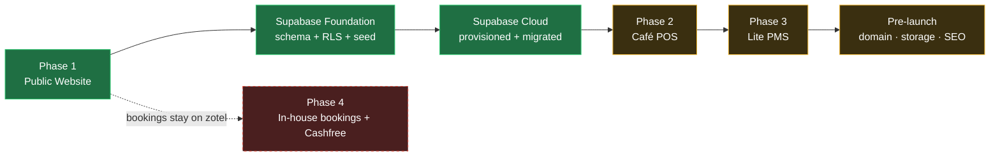
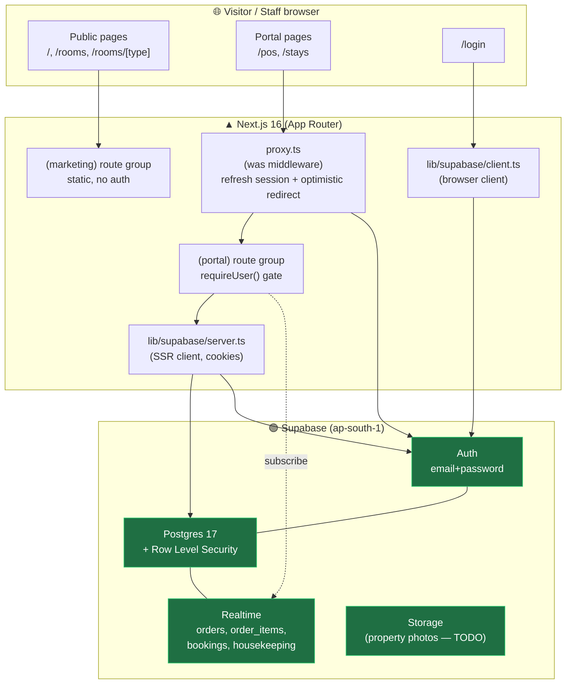
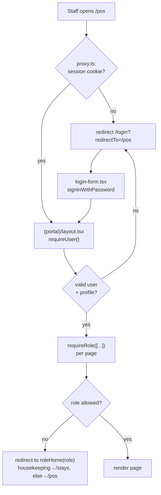
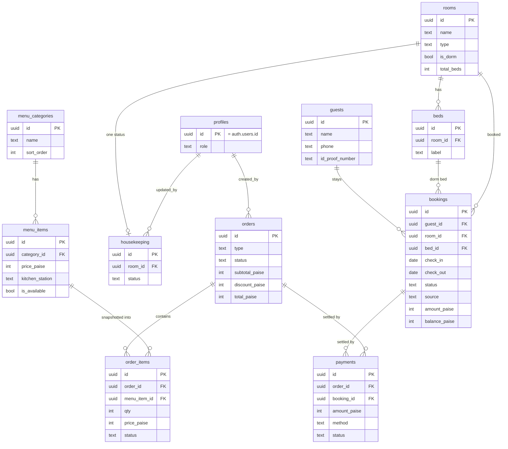
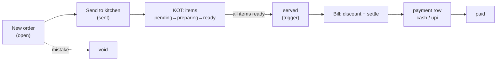

# Backpackers Storey — Codebase Guide

> Single source of truth for **what this project is, what's built, and what's left to build** to make it fully working.
> A small backpacker hostel + rooftop café in **Bir, Himachal Pradesh** — a marketing website plus a staff portal (café POS + lite PMS) on Supabase.

**Last updated:** 2026-06-30

---

## 1. At a glance

| | |
|---|---|
| **Product** | Public website (live-first) + internal staff portal (Café POS, Lite PMS) |
| **Property** | 6-bed dorm + ~3 private rooms + rooftop café, under the Billing paragliding launch |
| **Framework** | Next.js **16.2.9** (App Router, React **19.2.4**, TypeScript) |
| **Styling** | Tailwind CSS **v4** (`@tailwindcss/postcss`), custom design tokens in `globals.css` |
| **Backend** | Supabase (Postgres 17, Auth, Realtime, Storage) — project `TheBackpackStorey`, region `ap-south-1` (Mumbai) |
| **Auth** | Supabase Auth (email+password), `@supabase/ssr` cookie sessions, no public signup |
| **Icons / dates** | `lucide-react` 1.22, `date-fns` 4 |
| **Money** | Stored as **integer paise** everywhere (never floats) |
| **Bookings** | Outsourced to **zotel** (free) — in-house booking + Cashfree was **dropped** |

---

## 2. Status legend

| Mark | Meaning |
|---|---|
| ✅ | Done & verified |
| 🟡 | Scaffolded / partially done |
| ⬜ | Not started |
| ❌ | Decided against (out of scope) |

---

## 3. Build phases & overall status



| Phase | What | Status |
|---|---|---|
| **1 — Website** | Marketing site (landing, rooms, café, Bir, visit) | ✅ Done & build-verified |
| **Supabase foundation** | Migrations: schema, RLS, seed; app-side auth scaffold | ✅ Done & verified |
| **Supabase cloud** | Project provisioned, linked, migrations pushed, keys wired | ✅ Done & verified (2026-06-30) |
| **2 — Café POS** | Menu mgmt, order taking, live KOT, billing, daily totals | 🟡 In progress — **Menu management done**; order/KOT/billing/today next |
| **3 — Lite PMS** | Occupancy board, bookings, check-in/out, housekeeping | ⬜ Not started (placeholder live) |
| **Pre-launch** | Real domain, Storage for photos, SEO/OG, Lighthouse | ⬜ Pending |
| **4 — In-house bookings + Cashfree** | Own booking engine + room payments | ❌ Dropped — zotel is free; bookings stay there |

---

## 4. System architecture



**Request flow in words:**
1. Every request hits `src/proxy.ts` (Next 16's renamed middleware). It refreshes the Supabase session cookie and **optimistically** redirects unauthenticated `/pos` and `/stays` requests to `/login`.
2. The **authoritative** auth gate is `(portal)/layout.tsx`, which calls `requireUser()` → validates the token via `supabase.auth.getUser()` and loads the staffer's `profile.role`.
3. Public `(marketing)` pages never touch Supabase — they're static and work even with **blank** Supabase keys (so the website can ship before the backend).

---

## 5. Auth & roles



**Roles** (`profiles.role`, enforced by RLS *and* the app):

| Role | Café POS | Stays/PMS | Config (menu prices, rooms, accounts) |
|---|---|---|---|
| `owner` | ✅ full | ✅ full | ✅ |
| `manager` | ✅ full | ✅ full | ✅ |
| `reception` | ✅ full | ✅ full | menu only |
| `kitchen` | 👀 KOT read + advance item status | — | — |
| `housekeeping` | — | 🧹 housekeeping board only | — |

- **No public signup.** Owner creates accounts in Supabase dashboard → Authentication → Users. A trigger (`handle_new_user`) auto-creates a `profiles` row defaulting to `reception`; promote to `owner`/etc. via SQL.
- `public.user_role()` is a `SECURITY DEFINER` SQL function so RLS policies can read the caller's role without recursing on `profiles`.
- The **service_role** key bypasses RLS (server-only; used for admin tasks / future webhooks).

---

## 6. Data model



**Tables (11):** `profiles`, `menu_categories`, `menu_items`, `rooms`, `beds`, `guests`, `bookings`, `housekeeping`, `orders`, `order_items`, `payments`.

**Key invariants baked into the schema:**
- 💰 **Money is integer paise** with `>= 0` checks on every amount.
- 🔁 **Terminal states**: orders end at `paid`/`void`; bookings end at `checked_out`/`cancelled`/`no_show`; check `check_out > check_in`.
- 🚫 **No double-booking** via `btree_gist` exclusion constraints: overlapping *active* (`reserved`/`checked_in`) stays can't share a **bed** (dorm) or a **room** (private). Nights are `[check_in, check_out)`.
- 👨‍🍳 **Kitchen flow**: `order_items.status` goes `pending → preparing → ready`; a `SECURITY DEFINER` trigger (`sync_order_served`) flips the parent order to `served` once every item is `ready` — so kitchen staff only ever write `order_items`, never `orders`.
- 🔐 **RLS on every table**, gated by `user_role()` (see `0002_rls.sql`).
- ⚡ **Realtime** publication on `orders`, `order_items`, `bookings`, `housekeeping` (for the KOT and occupancy boards).

**Seed data (`0003_seed.sql`, idempotent):** 4 rooms (Dorm/Deluxe/Premium/Family), 6 dorm beds (D1–D6), 1 housekeeping row per room, 4 menu categories, 11 menu items (⚠️ **placeholder prices** — edit in POS → Menu management).

---

## 7. Repository layout

```
backpackers-storey/
├── codebase.md                      ← this file
├── AGENTS.md / CLAUDE.md            # "this is Next 16, read node_modules docs first"
├── next.config.ts · tsconfig.json · eslint.config.mjs · postcss.config.mjs
├── package.json
├── .env.local                       # Supabase + Cashfree keys (gitignored)
│
├── public/
│   └── photos/photo-01..13.jpg      # 13 real property photos (served locally for now)
│
├── supabase/
│   ├── config.toml                  # created by `supabase init`
│   ├── README.md                    # setup + staff-account + storage instructions
│   └── migrations/
│       ├── 0001_schema.sql          # tables, checks, triggers, exclusion constraints, realtime
│       ├── 0002_rls.sql             # row-level security policies per role
│       └── 0003_seed.sql            # rooms, beds, housekeeping, café menu (placeholder prices)
│
└── src/
    ├── proxy.ts                     # Next 16 middleware → session refresh + optimistic gate
    ├── lib/
    │   ├── site.ts                  # ⭐ single source of truth for ALL public content
    │   ├── auth.ts                  # getSessionProfile / requireUser / requireRole / roleHome
    │   └── supabase/
    │       ├── config.ts            # env readers + isSupabaseConfigured guard
    │       ├── client.ts            # browser client
    │       ├── server.ts            # SSR client (async cookies — Next 16)
    │       └── proxy-session.ts     # session refresh used by proxy.ts
    ├── components/
    │   ├── site-header.tsx · site-footer.tsx · booking-button.tsx (→ zotel)
    │   ├── room-card.tsx · elevation-tag.tsx · icon.tsx (lucide wrapper)
    │   └── portal/
    │       ├── sign-out-button.tsx
    │       └── placeholder.tsx      # phase scaffold shown on /pos & /stays
    └── app/
        ├── layout.tsx · globals.css # fonts + design tokens
        ├── sitemap.ts · robots.ts · not-found.tsx · favicon.ico
        ├── (marketing)/             # PUBLIC, no auth
        │   ├── layout.tsx
        │   ├── page.tsx             # landing (hero, rooms, café, amenities, Bir, visit)
        │   └── rooms/page.tsx · rooms/[type]/page.tsx
        ├── login/                   # page.tsx + login-form.tsx (client)
        └── (portal)/                # AUTH-GATED
            ├── layout.tsx           # requireUser() + role-filtered nav
            ├── pos/page.tsx         # Phase 2 placeholder
            └── stays/page.tsx       # Phase 3 placeholder
```

`src/lib/site.ts` is the content backbone: site facts (address, phones, check-in/out, coords, elevation), the 13 categorised photos + gallery, the 4 room definitions (copy + features grounded in the real listing), amenities, café, and experiences. **Room prices are deliberately omitted** — live rates stay on the booking page.

---

## 8. What's done ✅

### Phase 1 — Public website (done & build-verified)
- Brand design system: `globals.css` tokens (pine/forest/sage/amber palette) + Bricolage / Instrument / Space-Mono fonts.
- `src/lib/site.ts` content module with **real** scraped facts and the property's own 13 photos.
- Marketing shell (header/footer), landing page (hero → rooms → café → amenities → Bir → visit), `/rooms` index, `/rooms/[type]` detail for dorm/deluxe/premium/family.
- `sitemap.ts`, `robots.ts`, custom `404`.
- Booking CTA centralised in `booking-button.tsx` → zotel link (one-line swap point).

### Supabase foundation (done & verified)
- Three ordered migrations: schema, RLS, seed (see §6).
- App-side: `lib/supabase/{config,client,server,proxy-session}.ts`, `lib/auth.ts`, `proxy.ts`, `/login` (+ client form), `(portal)/layout.tsx` guard, role-gated `/pos` and `/stays` placeholders.
- Env-guarded so **blank keys don't break the public site**; `/pos` + `/stays` redirect to `/login` when signed out.

### Supabase cloud (done & verified — 2026-06-30)
- Project `TheBackpackStorey` (ref `hrzcmmyoyejsmpdijmuu`, Mumbai, PG17) provisioned.
- CLI installed (`brew`), `supabase link`, `supabase db push` → all 3 migrations applied to the live DB.
- Keys (URL + anon + service_role) written into `.env.local` (gitignored).
- **Verified live via REST**: rooms=4, menu_categories=4, menu_items=11, beds=6; bookings/orders/profiles correctly empty.

---

## 9. What's left to make it fully working ⬜

### A. Immediate setup tasks
- [ ] **Create the owner login** — add a staff user in Supabase Auth, promote to `owner` via SQL (see `supabase/README.md`). Without this nobody can enter the portal.
- [ ] **Commit** the new `supabase/config.toml` + `supabase/.gitignore` to the repo.

### B. Phase 2 — Café POS
`/pos` is now a real dashboard of cards (live vs. "soon"). Target screens:
- [x] **Menu management** — ✅ built at `/pos/menu`: edit prices (₹→paise), toggle availability, set kitchen station, add/remove items & categories. Server Actions in `src/lib/pos/actions.ts`, data in `src/lib/pos/menu.ts`, UI in `src/components/pos/menu-manager.tsx`. *(owner/manager/reception)*
- [ ] **New order** — dine-in / takeaway / room; add items (snapshot price into `order_items`), compute `subtotal/discount/total`.
- [ ] **Kitchen display (KOT)** — realtime list of `order_items`, tap to advance `pending → preparing → ready`; order auto-flips to `served` (trigger). *(kitchen)*
- [ ] **Billing** — apply discount, settle via cash/UPI, write a `payments` row, move order to `paid`; printable receipt.
- [ ] **Today** — totals by method, open vs paid.



### C. Phase 3 — Lite PMS ("Stays")
The placeholder at `/stays` lists the target screens:
- [ ] **Occupancy board** — rooms + dorm beds × 14 days, driven by `bookings` (exclusion constraints already prevent overlaps).
- [ ] **New / edit booking** — guest, room/bed, dates, source (`walk_in`/`website`/`zotel`/`ota`), amount + balance.
- [ ] **Check-in** — capture guest ID, set `checked_in`.
- [ ] **Check-out** — clear balance (payment row), set `checked_out`, room → `dirty`.
- [ ] **Housekeeping board** — `clean` / `dirty` / `in_progress`, realtime. *(+ housekeeping role)*
- [ ] **Guests** — searchable log with stay history.

```mermaid
flowchart LR
    R["reserved"] --> CI["checked_in<br/>(capture ID)"]
    CI --> CO["checked_out<br/>(settle balance)"]
    CO --> HK["room → dirty"]
    R -. "" .-> CX["cancelled"]
    R -. "no arrival" .-> NS["no_show"]
```

### D. Pre-launch
- [ ] **Storage**: create a public `property` bucket, upload `public/photos/`, point image paths at it (don't depend on zotel's CDN).
- [ ] **Real domain** + update `SITE.url`.
- [ ] **SEO/OG image**, favicon polish, mobile + Lighthouse pass.
- [ ] Reconcile name: painted sign says "The Backpacker Storey" (singular) vs brand "Backpackers Storey".

### E. Optional / later
- [ ] **Cashfree** settlement for café/PMS payments only (env keys present, `payments.method` supports `cashfree`). Not for room bookings — those stay on zotel.

---

## 10. Decisions on record
- **Phase 4 dropped (2026-06-29):** zotel is free, so room bookings stay on the zotel link permanently; no in-house booking engine. Cashfree may return *only* for café/PMS settlement.
- **Right-sizing:** smallest correct system, real scraped content (no invented prices/data), honest scoping.
- **Next.js 16, not 14:** `middleware` → `proxy`, async `cookies()`/`params`, Tailwind v4 — read `node_modules/next/dist/docs/` before writing Next code.

---

## 11. Local development

```bash
# from backpackers-storey/
npm install
npm run dev            # http://localhost:3000

# Supabase (already linked to project hrzcmmyoyejsmpdijmuu)
supabase db push       # apply new migrations
supabase migration new <name>   # author a new migration
```

`.env.local` keys: `NEXT_PUBLIC_SUPABASE_URL`, `NEXT_PUBLIC_SUPABASE_ANON_KEY`, `SUPABASE_SERVICE_ROLE_KEY` (set ✅), `CASHFREE_APP_ID`, `CASHFREE_SECRET_KEY` (blank). `NEXT_PUBLIC_*` are baked at **build time** — set them before `npm run build`.
